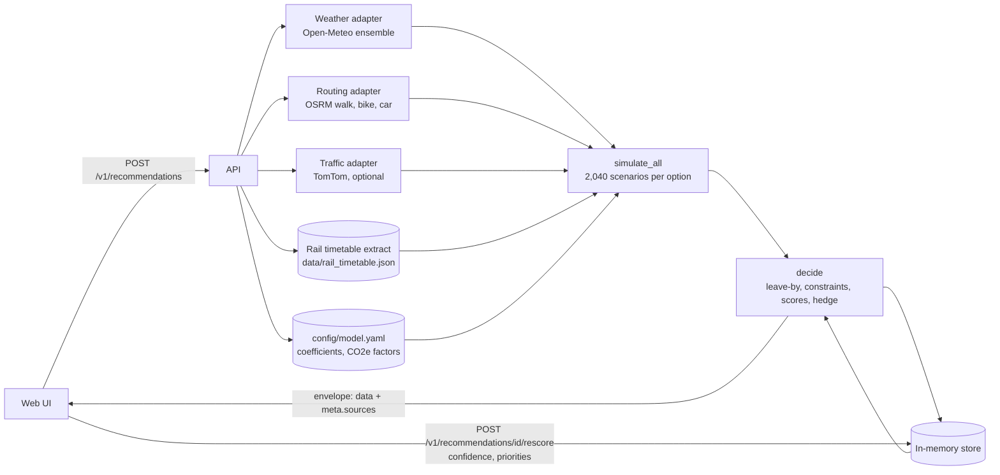

# Architecture

LeaveBy has three layers with one rule between them: adapters fetch, the decision layer decides, the API wires them together and publishes a contract.

| Layer | Where | What it does |
|---|---|---|
| Web UI | `web/` (React 19, Vite, Tailwind v4, shadcn/ui, motion, d3-scale/d3-shape) | Collects the trip, shows the verdict, charts and controls. Talks to the API only through `web/src/lib/api.ts`. |
| API | `backend/app/api/` (FastAPI, Pydantic) | Validates requests, calls adapters, runs the decision layer, stores results for rescoring, returns one response envelope. |
| Decision layer | `backend/app/decision/` (numpy) | Monte Carlo simulation, leave-by times, hard constraints, scoring and ranking, backup plan, explanations. Pure functions, no network. |
| Adapters | `backend/app/adapters/` | Open-Meteo ensemble weather, OSRM routing, Open-Meteo geocoding, TomTom traffic and incidents. Each returns data plus a `SourceMeta` (id, kind, age, licence). |
| Core | `backend/app/core/` | Config (`config/model.yaml`), mock data, the rail timetable extract and its builder, TTL cache, resilience, seeding, clock, `.env` loader. |

## Data flow

## Contract first

Every request and response is a Pydantic model in `backend/app/api/schemas.py`. `make openapi` writes `openapi.yaml` from the running app, and `tests/contract/test_openapi_contract.py` fails if the committed file drifts, so the contract only changes on purpose. The web types in `web/src/lib/types.ts` mirror the schemas.

Every response uses one envelope (`backend/app/api/envelope.py`): `{ ok, data, error, meta }`. `meta` carries a request id, `degraded`, plain-English `warnings` and the `sources` used, each with a kind: `live`, `static`, `mock`, `cached` or `estimated`. Errors use problem-style bodies with a fixed code set (`VALIDATION_ERROR`, `NOT_FOUND`, `RATE_LIMITED`, `UPSTREAM_UNAVAILABLE`, `INTERNAL`).

Endpoints: `POST /v1/recommendations`, `POST /v1/recommendations/{id}/rescore`, `GET /v1/recommendations/{id}/calendar.ics`, `GET /v1/geocode`, `GET /v1/sources`, `GET /v1/assumptions`, `GET /healthz`, `GET /readyz`.

## Resilience

All live calls go through `app/core/resilience.get_json`: a 3 second timeout, bounded retries with backoff and jitter on timeouts and 5xx only, and one error type (`UpstreamError`). Adapters cache answers in TTL caches (TomTom routes per 15 minute departure bucket, incidents for 5 minutes, OSRM routes for a day). When something fails the app still answers and says so:

- weather down: neutral weather, warning `WEATHER_UNAVAILABLE`, response marked degraded
- routing down: a straight-line estimate, warning `ROUTE_ESTIMATED`, source kind `estimated`
- TomTom down or no key: free-flow OSRM car time, warning `TRAFFIC_UNAVAILABLE` when a key was set
- geocoder down: a built-in UK list, marked as a fallback
- date outside the timetable: simulated trains, warning `TIMETABLE_OUT_OF_RANGE`

## The Monte Carlo engine

For each request the engine builds a grid of departure times per option and simulates every one under the same scenarios.

- **Scenarios.** The weather comes from the ECMWF IFS ensemble via Open-Meteo: 51 members. Each member is combined with 40 seeded noise draws (lognormal, median 1, spread per mode in `config/model.yaml`), giving 51 x 40 = 2,040 scenarios per option.
- **Common random numbers.** The noise is seeded from the request (origin, destination, deadline) and shared across options, so options are compared on the same mornings and the same request gives the same answer.
- **Weather effects.** Rain, headwind, gusts, ice and visibility slow walking, cycling and driving through capped factors (`backend/app/decision/weather_factor.py`). Strong gusts raise the chance of a train delay.
- **Trains.** With the real timetable (both ends within 3 km of one of 15 stations), each simulated train is a real scheduled train with its real ride time, on the deadline's local day only. Otherwise a generated timetable is used (05:30 to 23:30, a 15 minute headway, speed from a distance table). Delays are a lognormal mixture calibrated so that 86.5% of trains are within 5 minutes in calm weather.
- **Leave-by.** P(on time) is computed for every departure in the grid. The leave-by time is the latest departure whose P(on time) is at least the chosen confidence. If none qualifies, the option is infeasible with a plain reason (for example "No train runs early enough").
- **Hard constraints first.** No car, walking or cycling limits and step-free needs rule options out before the confidence test.
- **Backup plan.** Among the other feasible options, the one least often late on the same scenarios as the main plan (joint lateness), then the least late overall.
- **Rescore.** The simulation is stored, so changing the confidence or the priorities calls `POST /v1/recommendations/{id}/rescore`, which re-decides in a few milliseconds without calling any provider. The browser never re-runs the simulation.

## Scoring and priorities

Only feasible options are scored (`backend/app/decision/scoring.py`). Each criterion is min-max normalised across them so 1 is best: time (minutes before the deadline you must leave, lower is better), cost, carbon (both lower is better) and accessibility (higher is better). The composite score is the weighted sum with the user's priorities normalised to add up to 1 (defaults: time 40%, cost 20%, carbon 20%, access 20%). Ties go to higher P(on time), then lower cost. Flip points scan each priority from its current share up to 100% and report the smallest share at which another option would win. The web UI shows exactly these numbers, so the sliders, the ranking and the "why" sentences can never disagree.

## Trade-offs

- **One scoring function on the server.** The sliders call rescore instead of re-implementing the maths in the browser. Cost: a round trip of about 5 ms per change. Gain: no drift between UI and API.
- **Static timetable instead of a live feed.** Real scheduled trains for 15 stations from a 340 KB extract, rebuilt with `make rail-data`. No live running data, so delays stay modelled.
- **Free providers with honest labels.** Open-Meteo and OSRM need no key; TomTom is optional. Every number shows where it came from.
- **In-memory store.** Simple and fast for a demo; results expire on restart.

## With more time

- Live train running and disruption data (Darwin or Realtime Trains) and planned engineering works.
- Real fares (for example from the fares feed) and real step-free data (station accessibility data).
- Route the walk to and from the station instead of a fixed allowance; add buses from the Bus Open Data Service.
- A map with the route, stations and rain along the way.
- An offline demo mode that replays recorded provider responses, badged as recorded.
- A persistent store and deployment.
